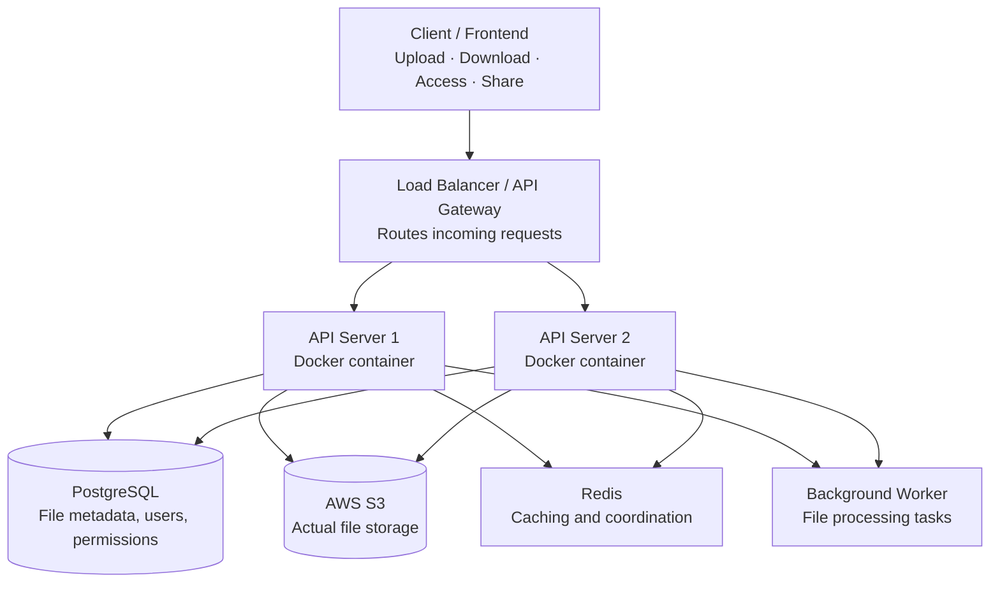

# Distributed File Management System.

A private place for students to keep their documents: notes, assignments, certificates. 
---
Distributed File Management System
Users can:
- Register and authenticate securely.
- Upload files of different formats.
- Download and access their files.
- Organize files into folders.
- Share files with other users.
- Track storage usage.
- Access files even when requests are handled by different application servers.

 
## Built with
A Full Python Fastapi Backend with Async , Pydantic , SqlAlchemy , Alembic Migration.
________________________________________________________________________________________

Distributed Architecture , Docker , AWS Cloud Deployment , CI/CD.
| Part | Tech |
|---|---|
| Backend      | FastAPI (Python) |
| Frontend     | JavaScript |
| Database     | PostgreSQL |
| Caching      | Redis |
| File storage | AWS S3 |

---

## Distributed system architecture

*Multiple instances of the same application run behind the load balancer.*

---

## About me

I'm Ritik, a final-year CS student.Distributed File Management System is my main resume project, so feedback, bug reports, and "why did you do it this way?" questions are all welcome. Open an issue, or find me on [GitHub](https://github.com/hm-ritik).
